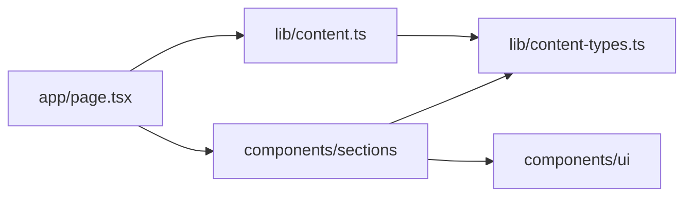
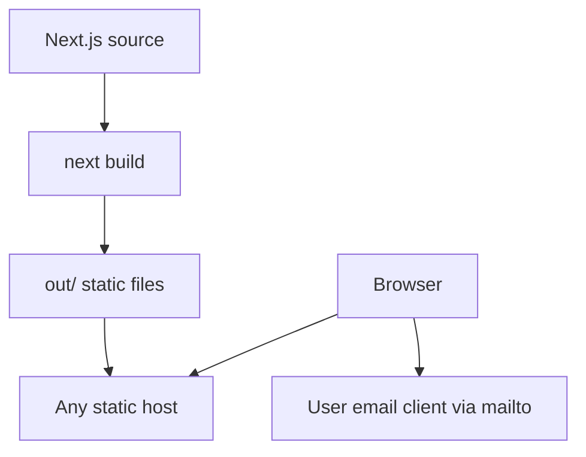

# Architecture Spine — Zoud AI Studio Landing Page

## Design Paradigm

Layered architecture with unidirectional static composition. `app/page.tsx` composes the route and injects typed content; `components/sections` renders that content through `components/ui`; neither section nor UI modules own product copy.



## Invariants & Rules

### AD-1 — Static export is the system boundary [ADOPTED]

- **Binds:** STORY-001 and all page capabilities
- **Prevents:** a story introducing a server, database, request-time rendering, or host-specific runtime
- **Rule:** `next build` must produce `out/`; production code may use only features supported by Next.js static export and must make no application API calls.

### AD-2 — One owner for public content

- **Binds:** STORY-003 through STORY-010
- **Prevents:** email addresses, prices, labels, or repeated copy diverging between sections
- **Rule:** approved copy and structured page data live once in `lib/content.ts`, satisfy readonly types in `lib/content-types.ts`, and enter sections only through props.

### AD-3 — Sections are presentational boundaries

- **Binds:** STORY-003 through STORY-010
- **Prevents:** circular dependencies and independently built sections choosing incompatible ownership or styling paths
- **Rule:** `app/page.tsx` alone fixes section order; section modules may import content types and UI primitives but must not import another section or the content singleton.

### AD-4 — Tokens own the visual language

- **Binds:** STORY-002 through STORY-010
- **Prevents:** incompatible colors, typography, spacing, radii, breakpoints, and arbitrary per-section values
- **Rule:** global CSS custom properties define the semantic palette, font scale, 4px spacing scale, radii, content width, and the single 48rem layout breakpoint; section styling lives beside its component in a CSS Module and consumes those tokens.

### AD-5 — Visual assets remain local and semantic

- **Binds:** STORY-002, STORY-004 through STORY-007
- **Prevents:** CDN availability/privacy failures, icon-library drift, and SVGs with inconsistent sizing or accessibility
- **Rule:** Inter Variable Latin upright is committed with its OFL license and loaded from a local WOFF2 by `next/font/local`; icons are typed local inline-SVG components with a 24px view box, `currentColor`, and decorative accessibility hidden unless a text alternative is required.

### AD-6 — Native HTML owns interaction

- **Binds:** STORY-003, STORY-009, STORY-010
- **Prevents:** unnecessary client state, hydration, or JavaScript-only conversion and disclosure behavior
- **Rule:** both CTAs are anchors using the exact shared mailto URI; FAQ items are independent native `details`/`summary` disclosures; section components remain server components.

### AD-7 — Acceptance is browser-observed

- **Binds:** STORY-001 through STORY-010 and NFR1 through NFR4
- **Prevents:** mocked tests passing while layout, navigation, export, accessibility, or performance is broken
- **Rule:** Playwright exercises the exported page at 375x812 and 1280x800; checks cover section order/content, overflow, 44px targets, mailto URIs, disclosure behavior, and responsive grids; Lighthouse CI checks performance and accessibility thresholds against `out/`.

## Consistency Conventions

| Concern | Convention |
| --- | --- |
| Naming | Components and files use PascalCase; content keys and props use camelCase; CSS classes use kebab-case scoped by section. |
| Data & formats | Content collections are readonly arrays with stable string IDs; prices are display strings because no calculation or payment exists; the shared URI is `mailto:hello@zoud.ae?subject=Free%20call%20request`. |
| State | There is no application state or mutation; FAQ openness is browser-owned DOM state and is not persisted. |
| Accessibility | One `h1`; section headings are `h2`; landmarks and labelled links are semantic; focus is visible; decorative SVGs are hidden from assistive technology. |
| Configuration | Static-export and quality-tool configuration is committed; public content is not sourced from environment variables. |

## Stack

| Name | Version |
| --- | --- |
| Node.js LTS | 26.13.0 |
| Next.js | 16.4.3 |
| React / React DOM | 19.3.1 |
| TypeScript | 7.0.2 |
| Playwright Test | 1.64.1 |
| ESLint | 10.14.0 |
| eslint-config-next | 16.4.3 |
| Lighthouse CI | 0.15.1 |

## Structural Seed

```text
app/
  layout.tsx          # metadata, local font, global page shell
  page.tsx            # sole owner of section order and content injection
  globals.css         # reset, tokens, shared layout utilities
components/
  sections/           # one component and CSS Module per page section
  ui/                 # ButtonLink, Card, Icon, Section primitives
lib/
  content-types.ts    # readonly public-content contracts
  content.ts          # sole owner of approved page copy and shared CTA URI
public/fonts/         # licensed local WOFF2 and license
scripts/
  serve-static.mjs    # dependency-free local server for exported files
tests/e2e/            # browser-observed story acceptance
next.config.ts        # static-export boundary
playwright.config.ts  # production-export browser matrix
lighthouserc.json     # performance and accessibility budgets
```



## Capability → Architecture Map

| Capability / Area | Lives in | Governed by |
| --- | --- | --- |
| Scaffold and static export | Next config, package scripts, Makefile, CI | AD-1, AD-7 |
| Design system and responsive shell | `app/globals.css`, local font | AD-4, AD-5 |
| Hero and conversion URI | `Hero`, `lib/content.ts` | AD-2, AD-3, AD-6 |
| Problem | `Problem` | AD-2 through AD-5 |
| How We Work | `HowWeWork` | AD-2 through AD-5 |
| What We Build | `WhatWeBuild` | AD-2 through AD-5 |
| Why Trust Us | `WhyTrustUs` | AD-2 through AD-5 |
| Pricing | `Pricing` | AD-2 through AD-4 |
| FAQ | `FAQ` | AD-2, AD-3, AD-6 |
| Final CTA and Footer | `FinalCTA`, `Footer` | AD-2, AD-3, AD-6 |
| Cross-story acceptance | `tests/e2e`, Lighthouse config | AD-7 |

## Deferred

- Hosting provider, DNS, analytics, and deployment automation are deferred until deployment enters scope; `out/` is provider-neutral.
- Localization, CMS ownership, and runtime content updates are deferred until content editors or multiple locales are required.
- Additional routes, legal pages, forms, scheduling, payments, and authentication are deferred because the approved product explicitly excludes them.
- Component-library extraction is deferred until a second page proves reuse beyond this landing page.
